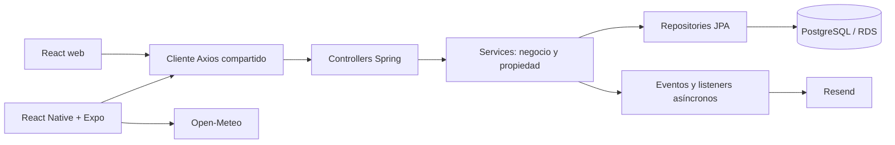

# StudyProgress

**CS2031 - Desarrollo Basado en Plataformas · 2026-2 · Grupo 7**

StudyProgress reúne cursos, temas, tareas, evaluaciones, objetivos y recordatorios para que un estudiante pueda elegir su siguiente actividad y observar el avance de su semestre. La segunda entrega incorpora una web en React, una aplicación React Native con Expo y las ampliaciones de API necesarias para que ambos clientes trabajen sobre los mismos datos persistentes.

Repositorio de la entrega: https://github.com/ZiroxTKL/StudyProgress-Full

Backend de la primera entrega: https://github.com/pedrochavezoscanoa/studyprogress-backend

## Enlaces de entrega

Registra aquí los enlaces definitivos después de verificar cada servicio desde otra red.

| Componente | Enlace |
|---|---|
| Web React en Vercel | Pendiente de publicación |
| API Spring Boot en AWS | Pendiente de publicación |
| APK Android en Expo EAS | Pendiente de publicación |

## Problema y objetivos

Un estudiante suele repartir sus fechas, pendientes y contenidos entre apuntes, mensajes y plataformas institucionales. Reconstruir esa información consume atención y dificulta distinguir qué debe estudiar, qué falta entregar y cuánto ha avanzado. StudyProgress centraliza la organización personal de cada materia. El alcance del producto es apoyar la planificación y el seguimiento académico; no reemplaza el registro oficial de notas de una universidad.

El objetivo general es ofrecer un espacio coherente en computadora y teléfono, con acceso individual a los recursos del estudiante. Los objetivos específicos son organizar cursos y actividades, registrar evaluaciones, mostrar el progreso calculado por el servidor, mantener sesiones seguras y facilitar el uso móvil con sensores que tengan una función concreta. La solución aplica la arquitectura en capas de Spring, persistencia JPA, APIs REST, React, TypeScript, hooks, Context API, consumo con Axios e integración con Expo estudiados en el curso.

## Funcionalidades

La web ofrece nueve vistas: ingreso, registro, resumen, cursos, detalle de curso, tareas, objetivos, recordatorios y perfil. El resumen muestra información real del usuario: cursos activos, actividades pendientes y completadas, objetivos logrados, puntos y progreso por materia. Desde el detalle se crean y editan temas, tareas y evaluaciones; completar una actividad actualiza el progreso, y una evaluación admite notas entre 0 y 20. Se identifica el promedio como simple porque el servicio heredado de la primera entrega calcula esa medida, aunque cada evaluación conserve su ponderación.

Los listados de cursos y tareas consultan páginas en el backend. Incluyen búsqueda, ordenamiento, tamaños de 10, 25, 50 y 100 elementos y controles con totales. La URL conserva `page`, `size`, `search` y `sort`, por lo que el historial y los enlaces reflejan la consulta. Las páginas protegidas requieren sesión, las vistas se cargan bajo demanda y las rutas desconocidas tienen una respuesta 404 de interfaz.

La app utiliza la misma API para las funciones académicas. La cámara importa una plantilla de curso desde un QR generado en la web. Antes de guardar, permite revisar el nombre y los temas. El QR no comparte identificadores de cuenta, tokens, tareas ni calificaciones. Como segundo sensor, la ubicación permite consultar Open-Meteo y valorar si una sesión de estudio al aire libre puede resultar cómoda. La sugerencia considera temperatura, precipitación y viento; es orientativa. El usuario puede pegar el contenido QR o ingresar coordenadas si faltan sensores o permisos. Estas consultas no sustituyen la API propia ni almacenan la ubicación en el perfil.

## Arquitectura

```text
src/                         Backend Spring Boot de la primera entrega + API v1
web/src/                     React: pages, components, hooks, contexts, services
mobile/src/                  React Native: screens, components, hooks, contexts, services
packages/client/src/         Tipos, cliente Axios y validaciones compartidas
```



Los controladores de `/api/v1` delegan a servicios que verifican el usuario autenticado antes de acceder o modificar recursos. `PortalService` agrupa los casos que necesita el cliente y reutiliza los servicios de la entrega 1. Los mappers entregan DTOs. Los repositorios paginados incluyen el correo del dueño en la consulta SQL; no descargan datos de otros usuarios ni recortan listas en memoria. La importación QR utiliza una transacción para guardar el curso con sus temas. Al eliminar un curso se eliminan primero sus actividades relacionadas dentro de la misma transacción.

El modelo conserva Usuario, Curso, Tema, Tarea, Evaluación, Objetivo y Recordatorio. Agrega RefreshSession para renovar sesiones por dispositivo. Cada usuario tiene cursos, objetivos, recordatorios y sesiones; cada curso contiene temas, tareas y evaluaciones.

## Despliegue

El contenedor del backend compila con Java 21. La web y la app comparten las dependencias y el cliente desde la raíz del repositorio. Usa Node 24 para instalar y compilar los clientes.

### PostgreSQL en RDS y backend en EC2

1. Crea una base PostgreSQL llamada `studyprogress` en RDS. Mantén la base privada y permite el puerto 5432 desde el grupo de seguridad del backend.
2. En EC2, configura un archivo `.env` basado en `.env.example`. Completa la URL JDBC con el endpoint real de RDS, el usuario, la contraseña y un `JWT_SECRET` aleatorio. Define `ALLOWED_ORIGINS` con la URL HTTPS de Vercel, sin barra final, y conserva `COOKIE_SECURE=true`. El Dockerfile incluye el certificado raíz de RDS que usa la URL JDBC de ejemplo.
3. Construye y arranca la imagen detrás del proxy HTTPS del servidor. Si el proxy se ejecuta en la misma instancia, puede llegar a Spring Boot en el puerto local 8080.

```bash
docker build -t studyprogress-api .
docker run -d --name studyprogress-api --restart unless-stopped --env-file .env -p 127.0.0.1:8080:8080 studyprogress-api
```

Comprueba que `https://api.example.com/health` responda usando el dominio real. Configura el certificado y conserva las credenciales de RDS y de sesión en el servidor. [Conexión TLS a PostgreSQL en RDS](https://docs.aws.amazon.com/AmazonRDS/latest/UserGuide/PostgreSQL.Concepts.General.SSL.html)

### Web en Vercel

Importa el repositorio con la raíz del proyecto en `.`, instala con `npm ci`, compila con `npm run build` y publica `web/dist`. Configura `VITE_API_BASE_URL=/api/v1`. Añade un `vercel.json` en la raíz con las siguientes reescrituras y reemplaza `api.example.com` por el dominio HTTPS de tu API.

```json
{
  "rewrites": [
    { "source": "/api/:path*", "destination": "https://api.example.com/api/:path*" },
    { "source": "/:path*", "destination": "/index.html" }
  ]
}
```

La primera regla mantiene las solicitudes de sesión en el dominio de la web. La segunda permite abrir rutas como `/cursos` directamente. [Vite en Vercel](https://vercel.com/docs/frameworks/frontend/vite) · [Reescrituras en Vercel](https://vercel.com/docs/routing/rewrites)

### App Android en Expo EAS

El perfil `preview` de `mobile/eas.json` genera una APK de distribución interna. Usa una cuenta con acceso al proyecto Expo configurado en `mobile/app.json` y reemplaza el dominio de ejemplo por el de la API pública.

```powershell
cd mobile
npx eas-cli@latest login
npx eas-cli@latest env:set --name EXPO_PUBLIC_API_URL --value https://api.example.com/api/v1 --environment preview --visibility plaintext
npx eas-cli@latest build --platform android --profile preview
```

Comparte el enlace de instalación que genera EAS. La app instalada se conecta al backend por HTTPS. [Distribución interna con EAS](https://docs.expo.dev/build/internal-distribution/) · [Variables de EAS Build](https://docs.expo.dev/eas/environment-variables/usage/)

### Comprobar la entrega publicada

Registra una cuenta nueva desde la web, crea un curso y ábrelo con la misma cuenta en la APK instalada. Comprueba que las sesiones se mantengan al recargar y que funcionen el lector QR, la ubicación y las alternativas al denegar permisos. Usa `postman_collection.json` para revisar la API con una cuenta de prueba.

## Seguridad y errores

Spring Security protege la API y los servicios comprueban la propiedad de los datos. Las contraseñas utilizan BCrypt y no se devuelven en las respuestas. El acceso JWT dura 15 minutos por defecto. La web guarda ese token en memoria y utiliza una cookie de renovación HttpOnly, SameSite Strict y Secure en producción. Por ello, la web usa una reescritura de Vercel para servir `/api` desde el mismo origen. Las operaciones de sesión verifican Origin y rechazan solicitudes marcadas como cross-site.

En móvil, Axios envía el token Bearer y renueva usando un refresh guardado con SecureStore. El refresh es aleatorio, dura siete días y el servidor solo guarda su hash SHA-256. Cada renovación consume el token previo bajo bloqueo de fila y emite otro. Cerrar sesión revoca el refresh del dispositivo y elimina las credenciales locales; el token de acceso ya emitido puede seguir siendo válido hasta su expiración. La implementación no promete revocación inmediata de todos los JWT.

Los interceptores centralizan autenticación y reintentan únicamente lecturas recuperables. No repiten escrituras después de una pérdida de conexión, para evitar duplicados. Los hooks cancelan lecturas con AbortController al cambiar de vista. Las pantallas incluyen cargas, errores, estados vacíos, confirmación de eliminación y prevención de doble envío. Las validaciones compartidas con Zod dan respuesta temprana, y Jakarta Validation vuelve a validar en el servidor. Los mensajes de error ocultan detalles internos de infraestructura.

Los eventos de registro, objetivos y recordatorios de la primera entrega se conservan. El correo exige `EMAIL_ENABLED=true`, una API key Resend y un remitente autorizado. El scheduler de recordatorios solo se activa al habilitar el servicio. Todas las claves reales se inyectan mediante variables de entorno.

## Pruebas

```powershell
.\mvnw.cmd verify
npm ci
npm run typecheck
npm test
npm run build
npm exec -w mobile -- expo install --check
```

Los contratos JUnit comprueban autenticación, propiedad, paginación, progreso y concurrencia. PostgreSQL 16 se prueba con Testcontainers cuando Docker está disponible. La base en memoria se limita a las pruebas automatizadas. Vitest comprueba validaciones, QR y formularios. GitHub Actions ejecuta la validación de backend y clientes en cada push y pull request.

## Equipo y participación

Participación declarada por el equipo para esta entrega: **100 % por integrante**. El porcentaje representa cumplimiento individual de responsabilidades, no una distribución que deba sumar 100 %. Los aportes de la siguiente tabla fueron confirmados por el equipo.

| Integrante | Principales aportes | Participación |
|---|---|---:|
| Pedro Maximo Chavez Oscanoa | Backend, modelo de datos y contratos REST | 100 % |
| Marcelo Mateo Rosillo Rodriguez | Web React, vistas, componentes y formularios | 100 % |
| Jorge Andrés Cuevas Sánchez | React Native, sensores y API de clima | 100 % |
| Aquino Reyna Jesús Emmanuel | Autenticación, seguridad e integración de clientes | 100 % |
| Leonardo Martinez Aquino | Pruebas, contenedores y preparación de despliegue | 100 % |

## Conclusiones y referencias

La segunda entrega convierte el backend en una experiencia utilizable desde dos plataformas, conserva una única fuente de datos académicos y agrega sesiones renovables y paginación real. La modularidad permite ampliar filtros o estadísticas sin duplicar la lógica de negocio entre dispositivos. Antes de presentar, el equipo debe demostrar el stack publicado y los sensores en un teléfono,.

Proyecto académico. El material recibido no declara una licencia de código abierto; esta entrega no concede una licencia adicional sobre el trabajo original.

Referencias técnicas: [React](https://react.dev/learn), [React Router](https://reactrouter.com/), [Axios](https://axios-http.com/docs/interceptors), [Spring Boot](https://docs.spring.io/spring-boot/), [Expo Camera](https://docs.expo.dev/versions/latest/sdk/camera/), [Expo Location](https://docs.expo.dev/versions/latest/sdk/location/), [Expo SecureStore](https://docs.expo.dev/versions/latest/sdk/securestore/), [Open-Meteo](https://open-meteo.com/en/docs), [Testcontainers PostgreSQL](https://java.testcontainers.org/modules/databases/postgres/).
