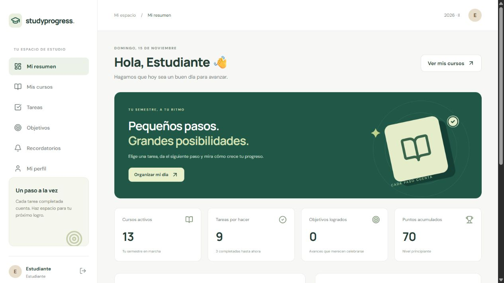
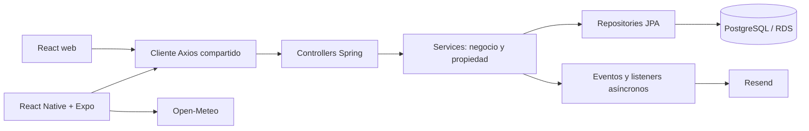

# StudyProgress

**CS2031 - Desarrollo Basado en Plataformas · 2026-2 · Grupo 7**

StudyProgress reúne cursos, temas, tareas, evaluaciones, objetivos y recordatorios para que un estudiante pueda elegir su siguiente actividad y observar el avance de su semestre. La segunda entrega incorpora una web en React, una aplicación React Native con Expo y las ampliaciones de API necesarias para que ambos clientes trabajen sobre los mismos datos persistentes.

Repositorio de la entrega: https://github.com/ZiroxTKL/StudyProgress-Full

Backend de la primera entrega: https://github.com/pedrochavezoscanoa/studyprogress-backend

## Enlaces de entrega

Servicios comprobados el 15 de noviembre de 2026. La API depende de que la instancia del Learner Lab esté encendida.

| Componente | Enlace |
|---|---|
| Web React en Vercel | [Abrir StudyProgress](https://studyprogress-grupo7.vercel.app) |
| API Spring Boot en AWS EC2 | [API v1](https://54.160.202.67/api/v1) · [Estado del servicio](https://54.160.202.67/health) |
| APK Android en Expo EAS | [Descargar APK 2.0.0](https://expo.dev/artifacts/eas/L6NJAoNOqCVIdWI7LP2uYfuDng-3zyA5u0qcBBrnFHk.apk) · [Build de Expo](https://expo.dev/accounts/roedeer/projects/studyprogress-grupo7/builds/8e3d6af2-a01d-4702-9e05-419d3f30c927) |

Cuenta de demostración: `demo@studyprogress.example` / `DemoStudy2026`. Contiene datos de ejemplo compartidos para la evaluación. También se puede registrar una cuenta propia.

Presentación: [pitch y demo de 20 minutos](docs/StudyProgress-presentacion.pptx).



## Problema y objetivos

Un estudiante suele repartir sus fechas, pendientes y contenidos entre apuntes, mensajes y plataformas institucionales. Reconstruir esa información consume atención y dificulta distinguir qué debe estudiar, qué falta entregar y cuánto ha avanzado. StudyProgress centraliza la organización personal de cada materia. El alcance del producto es apoyar la planificación y el seguimiento académico; no reemplaza el registro oficial de notas de una universidad.

El objetivo general es ofrecer un espacio coherente en computadora y teléfono, con acceso individual a los recursos del estudiante. Los objetivos específicos son organizar cursos y actividades, registrar evaluaciones, mostrar el progreso calculado por el servidor, mantener sesiones seguras y facilitar el uso móvil con sensores que tengan una función concreta. La solución aplica la arquitectura en capas de Spring, persistencia JPA, APIs REST, React, TypeScript, hooks, Context API, consumo con Axios e integración con Expo estudiados en el curso.

## Funcionalidades

La web ofrece nueve vistas: ingreso, registro, resumen, cursos, detalle de curso, tareas, objetivos, recordatorios y perfil. El resumen muestra información real del usuario: cursos activos, actividades pendientes y completadas, objetivos logrados, puntos y progreso por materia. Desde el detalle se crean y editan temas, tareas y evaluaciones; completar una actividad actualiza el progreso, y una evaluación admite notas entre 0 y 20. Se identifica el promedio como simple porque el servicio heredado de la primera entrega calcula esa medida, aunque cada evaluación conserve su ponderación.

Los listados de cursos y tareas consultan páginas en el backend. Incluyen búsqueda, ordenamiento, tamaños de 10, 25, 50 y 100 elementos y controles con totales. La URL conserva `page`, `size`, `search` y `sort`, por lo que el historial y los enlaces reflejan la consulta. Las páginas protegidas requieren sesión, las vistas se cargan bajo demanda y las rutas desconocidas tienen una respuesta 404 de interfaz.

La app utiliza la misma API para las funciones académicas. La cámara importa una plantilla de curso desde un QR generado en la web. Antes de guardar, permite revisar el nombre y los temas. El QR no comparte identificadores de cuenta, tokens, tareas ni calificaciones. Como segundo sensor, la ubicación permite consultar Open-Meteo y valorar si una sesión de estudio al aire libre puede resultar cómoda. La sugerencia considera temperatura, precipitación y viento; es orientativa. El usuario puede pegar el contenido QR o ingresar coordenadas si faltan sensores o permisos. Estas consultas no sustituyen la API propia ni almacenan la ubicación en el perfil.

## Arquitectura

```text
src/                         Backend Spring Boot de la primera entrega + API v1
web/src/                     React: pages, components, hooks, contexts, services
mobile/src/                  React Native: screens, components, hooks, contexts, services
packages/client/src/         Tipos, cliente Axios y validaciones compartidas
```



Los controladores de `/api/v1` delegan a servicios que verifican el usuario autenticado antes de acceder o modificar recursos. `PortalService` agrupa los casos que necesita el cliente y reutiliza los servicios de la entrega 1. Los mappers entregan DTOs. Los repositorios paginados incluyen el correo del dueño en la consulta SQL; no descargan datos de otros usuarios ni recortan listas en memoria. La importación QR utiliza una transacción para guardar el curso con sus temas. Al eliminar un curso se eliminan primero sus actividades relacionadas dentro de la misma transacción.

El modelo conserva Usuario, Curso, Tema, Tarea, Evaluación, Objetivo y Recordatorio. Agrega RefreshSession para renovar sesiones por dispositivo. Cada usuario tiene cursos, objetivos, recordatorios y sesiones; cada curso contiene temas, tareas y evaluaciones.

## Despliegue

La web está publicada en Vercel, la API en EC2 y PostgreSQL en RDS, en Norte de Virginia (`us-east-1`). La APK firmada se distribuye mediante Expo EAS. Los clientes comparten el contrato de `/api/v1` y acceden a la misma base persistente.

### AWS: API y PostgreSQL

La infraestructura está definida en [deploy/aws/cloudformation.json](deploy/aws/cloudformation.json): EC2 `t3.small`, PostgreSQL 16 en RDS `db.t3.micro`, discos cifrados, un bucket S3 privado para paquetes y una dirección IPv4 elástica. Se reutiliza `LabInstanceProfile` para administrar la instancia mediante Systems Manager.

RDS no tiene acceso público. El puerto 5432 acepta conexiones únicamente desde el grupo de seguridad del backend. La conexión JDBC exige `sslmode=verify-full` y utiliza el certificado raíz oficial de RDS. El backend se ejecuta con Java 21, usuario sin privilegios y sistema de archivos de solo lectura dentro de su contenedor.

[Caddyfile](deploy/aws/Caddyfile) publica HTTPS y [start.sh](deploy/aws/start.sh) inicia los contenedores, comprueba la salud de Spring y conserva los certificados en volúmenes Docker. El certificado público de la IP utiliza el perfil `shortlived` de Let's Encrypt y se renueva automáticamente mientras el servidor está activo. [Certificados de IP](https://letsencrypt.org/2026/01/15/6day-and-ip-general-availability/) · [TLS de RDS](https://docs.aws.amazon.com/AmazonRDS/latest/UserGuide/PostgreSQL.Concepts.General.SSL.html)

La contraseña de RDS y `JWT_SECRET` se generan fuera del repositorio. La configuración de producción se inyecta mediante un archivo de entorno privado, con `COOKIE_SECURE=true` y `ALLOWED_ORIGINS` limitado a los dominios publicados. `EMAIL_ENABLED=false` evita enviar correos durante la demostración.

El consumo estimado de esta configuración es aproximadamente US$1.20 por 24 horas con todo encendido, antes de créditos y tráfico adicional. RDS, los discos y la IP pueden seguir consumiendo presupuesto con EC2 apagado.

### Web en Vercel

El proyecto `dbp67/studyprogress-grupo7` utiliza el plan Hobby. La raíz de compilación es el repositorio completo: `npm ci`, `npm run build` y salida `web/dist`. `VITE_API_BASE_URL=/api/v1` está configurada en producción.

[vercel.json](vercel.json) sirve las rutas de React y reenvía `/api/*` por HTTPS hacia EC2. Las solicitudes de sesión conservan el origen de la web, por lo que la cookie HttpOnly se puede renovar sin depender de cookies de terceros. La configuración también agrega las cabeceras de seguridad de la web.

### APK Android en Expo EAS

El proyecto Expo es `@roedeer/studyprogress-grupo7`. El perfil `preview` genera una APK de distribución interna, con la URL de AWS definida en el entorno `preview` de EAS. La versión publicada es `2.0.0`, build Android `1`.

```powershell
cd mobile
npx eas-cli@latest env:set preview --name EXPO_PUBLIC_API_URL --value https://54.160.202.67/api/v1 --visibility plaintext
npx eas-cli@latest build --platform android --profile preview
```

La cámara y la ubicación se prueban desde **Herramientas**. Para el QR, abre un curso en la web, pulsa **Compartir QR**, escanéalo con **Abrir cámara** en la APK y confirma la importación. **Usar mi ubicación** consulta Open-Meteo y muestra la recomendación de estudio. [Distribución interna con EAS](https://docs.expo.dev/build/internal-distribution/)

### Antes de la exposición

1. Abre AWS Academy → Módulos → Learner Lab y pulsa **Start Lab**. Espera el indicador verde y abre la consola AWS desde el laboratorio.
2. En EC2, comprueba que la instancia **StudyProgress** esté en ejecución. Si figura detenida, iníciala.
3. Abre [health](https://54.160.202.67/health) y comprueba `status: UP`. Luego prueba el ingreso desde Vercel y la APK.

El curso establece sesiones de cuatro horas y apagado automático de EC2 al finalizar. Los datos permanecen en RDS y la IP elástica se conserva; el entorno no garantiza disponibilidad las 24 horas. Después de la evaluación se deben revisar los recursos que continuarán consumiendo presupuesto.

## Seguridad y errores

Spring Security protege la API y los servicios comprueban la propiedad de los datos. Las contraseñas utilizan BCrypt y no se devuelven en las respuestas. El acceso JWT dura 15 minutos por defecto. La web guarda ese token en memoria y utiliza una cookie de renovación HttpOnly, SameSite Strict y Secure en producción. Por ello, la web usa una reescritura de Vercel para servir `/api` desde el mismo origen. Las operaciones de sesión verifican Origin y rechazan solicitudes marcadas como cross-site.

En móvil, Axios envía el token Bearer y renueva usando un refresh guardado con SecureStore. El refresh es aleatorio, dura siete días y el servidor solo guarda su hash SHA-256. Cada renovación consume el token previo bajo bloqueo de fila y emite otro. Cerrar sesión revoca el refresh del dispositivo y elimina las credenciales locales; el token de acceso ya emitido puede seguir siendo válido hasta su expiración. La implementación no promete revocación inmediata de todos los JWT.

Los interceptores centralizan autenticación y reintentan únicamente lecturas recuperables. No repiten escrituras después de una pérdida de conexión, para evitar duplicados. Los hooks cancelan lecturas con AbortController al cambiar de vista. Las pantallas incluyen cargas, errores, estados vacíos, confirmación de eliminación y prevención de doble envío. Las validaciones compartidas con Zod dan respuesta temprana, y Jakarta Validation vuelve a validar en el servidor. Los mensajes de error ocultan detalles internos de infraestructura.

Los eventos de registro, objetivos y recordatorios de la primera entrega se conservan. El correo exige `EMAIL_ENABLED=true`, una API key Resend y un remitente autorizado. El scheduler de recordatorios solo se activa al habilitar el servicio. Todas las claves reales se inyectan mediante variables de entorno.

## Pruebas

```powershell
.\mvnw.cmd verify
npm ci
npm run typecheck
npm test
npm run build
npm exec -w mobile -- expo install --check
```

Los contratos JUnit comprueban autenticación, propiedad, paginación, progreso y concurrencia. PostgreSQL 16 se prueba con Testcontainers cuando Docker está disponible. La base en memoria se limita a las pruebas automatizadas. Vitest comprueba validaciones, QR y formularios. GitHub Actions ejecuta la validación de backend y clientes en cada push y pull request.

### Verificación del despliegue público

La versión publicada pasó 17 comprobaciones de API: HTTPS, autenticación, cookie segura, renovación web y móvil, revocación, datos persistentes, aislamiento entre usuarios, importación de cursos y paginación de cursos y tareas. Otras cinco comprobaciones verificaron la web pública y el proxy de Vercel, incluyendo login y renovación de sesión. También se comprobó el ingreso y la recarga de sesión en un navegador.

| Endpoint | Solicitudes medidas | Promedio |
|---|---:|---:|
| `/api/v1/dashboard` | 10 | 225 ms |
| `/api/v1/cursos?size=10` | 10 | 174 ms |
| `/api/v1/tareas?size=10` | 10 | 129 ms |

Las mediciones utilizaron HTTPS con conexión persistente desde el equipo de prueba, sin carga concurrente. Describen esa comprobación; no constituyen una garantía de latencia o disponibilidad futura.

El equipo confirmó el ingreso y la importación QR desde un teléfono Android. La comprobación física de ubicación y clima está pendiente de confirmación.

## Equipo y participación

Participación declarada por el equipo para esta entrega: **100 % por integrante**. El porcentaje representa cumplimiento individual de responsabilidades, no una distribución que deba sumar 100 %. Los aportes de la siguiente tabla fueron confirmados por el equipo.

| Integrante | Principales aportes | Participación |
|---|---|---:|
| Marcelo Mateo Rosillo Rodriguez | Web React, vistas, componentes y formularios | 100 % |
| Leonardo Martinez Aquino | Pruebas, contenedores y preparación de despliegue | 100 % |

## Conclusiones y referencias

La segunda entrega convierte el backend en una experiencia utilizable desde dos plataformas, conserva una única fuente de datos académicos y agrega sesiones renovables y paginación real. La modularidad permite ampliar filtros o estadísticas sin duplicar la lógica de negocio entre dispositivos. La exposición incluye una demostración del stack publicado y el uso de los sensores desde un teléfono.

Proyecto académico. El material recibido no declara una licencia de código abierto; esta entrega no concede una licencia adicional sobre el trabajo original.

Referencias técnicas: [React](https://react.dev/learn), [React Router](https://reactrouter.com/), [Axios](https://axios-http.com/docs/interceptors), [Spring Boot](https://docs.spring.io/spring-boot/), [Expo Camera](https://docs.expo.dev/versions/latest/sdk/camera/), [Expo Location](https://docs.expo.dev/versions/latest/sdk/location/), [Expo SecureStore](https://docs.expo.dev/versions/latest/sdk/securestore/), [Open-Meteo](https://open-meteo.com/en/docs), [Testcontainers PostgreSQL](https://java.testcontainers.org/modules/databases/postgres/).
