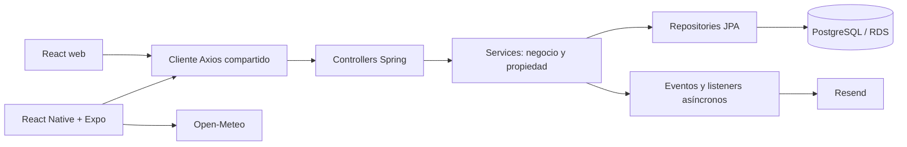

# StudyProgress

**CS2031 - Desarrollo Basado en Plataformas · 2026-2 · Grupo 7**

StudyProgress reúne cursos, temas, tareas, evaluaciones, objetivos y recordatorios para que un estudiante pueda elegir su siguiente actividad y observar el avance de su semestre. Esta preparación se entrega para ejecución local; la publicación externa queda para una etapa posterior. La segunda entrega incorpora una web en React, una aplicación React Native con Expo y las ampliaciones de API necesarias para que ambos clientes trabajen sobre los mismos datos persistentes.

Repositorio de la entrega: https://github.com/ZiroxTKL/StudyProgress-Full

Backend de la primera entrega: https://github.com/pedrochavezoscanoa/studyprogress-backend

## Contenido

1. [Problema y objetivos](#problema-y-objetivos)
2. [Funcionalidades](#funcionalidades)
3. [Arquitectura](#arquitectura)
4. [Ejecución local](#ejecución-local)
5. [App móvil](#app-móvil)
6. [Seguridad y errores](#seguridad-y-errores)
7. [Pruebas](#pruebas)
8. [Despliegue y documentación](#despliegue-y-documentación)
9. [Equipo y participación](#equipo-y-participación)

## Problema y objetivos

Un estudiante suele repartir sus fechas, pendientes y contenidos entre apuntes, mensajes y plataformas institucionales. Reconstruir esa información consume atención y dificulta distinguir qué debe estudiar, qué falta entregar y cuánto ha avanzado. StudyProgress centraliza la organización personal de cada materia. El alcance del producto es apoyar la planificación y el seguimiento académico; no reemplaza el registro oficial de notas de una universidad.

El objetivo general es ofrecer un espacio coherente en computadora y teléfono, con acceso individual a los recursos del estudiante. Los objetivos específicos son organizar cursos y actividades, registrar evaluaciones, mostrar el progreso calculado por el servidor, mantener sesiones seguras y facilitar el uso móvil con sensores que tengan una función concreta. La solución aplica la arquitectura en capas de Spring, persistencia JPA, APIs REST, React, TypeScript, hooks, Context API, consumo con Axios e integración con Expo estudiados en el curso.

## Funcionalidades

La web ofrece nueve vistas: ingreso, registro, resumen, cursos, detalle de curso, tareas, objetivos, recordatorios y perfil. El resumen muestra información real del usuario: cursos activos, actividades pendientes y completadas, objetivos logrados, puntos y progreso por materia. Desde el detalle se crean y editan temas, tareas y evaluaciones; completar una actividad actualiza el progreso, y una evaluación admite notas entre 0 y 20. Se identifica el promedio como simple porque el servicio heredado de la primera entrega calcula esa medida, aunque cada evaluación conserve su ponderación.

Los listados de cursos y tareas consultan páginas en el backend. Incluyen búsqueda, ordenamiento, tamaños de 10, 25, 50 y 100 elementos y controles con totales. La URL conserva `page`, `size`, `search` y `sort`, por lo que el historial y los enlaces reflejan la consulta. Las páginas protegidas requieren sesión, las vistas se cargan bajo demanda y las rutas desconocidas tienen una respuesta 404 de interfaz.

La app utiliza la misma API para las funciones académicas. La cámara importa una plantilla de curso desde un QR generado en la web. Antes de guardar, permite revisar el nombre y los temas. El QR no comparte identificadores de cuenta, tokens, tareas ni calificaciones. Como segundo sensor, la ubicación permite consultar Open-Meteo y valorar si una sesión de estudio al aire libre puede resultar cómoda. La sugerencia considera temperatura, precipitación y viento; es orientativa. El usuario puede pegar el contenido QR o ingresar coordenadas si faltan sensores o permisos. Estas consultas no sustituyen la API propia ni almacenan la ubicación en el perfil.

## Arquitectura

```text
src/                         Backend Spring Boot de la primera entrega + API v1
web/src/                     React: pages, components, hooks, contexts, services
mobile/src/                  React Native: screens, components, hooks, contexts, services
packages/client/src/         Tipos, cliente Axios y validaciones compartidas
scripts/                     Preparación local, datos de demo y medición de despliegue
deploy/                      Caddy, configuración HTTPS y proxy
docs/                        Matriz de rúbrica, guía, guion y evidencias
```



Los controladores de `/api/v1` delegan a servicios que verifican el usuario autenticado antes de acceder o modificar recursos. `PortalService` agrupa los casos que necesita el cliente y reutiliza los servicios de la entrega 1. Los mappers entregan DTOs. Los repositorios paginados incluyen el correo del dueño en la consulta SQL; no descargan datos de otros usuarios ni recortan listas en memoria. La importación QR utiliza una transacción para guardar el curso con sus temas. Al eliminar un curso se eliminan primero sus actividades relacionadas dentro de la misma transacción.

El modelo conserva Usuario, Curso, Tema, Tarea, Evaluación, Objetivo y Recordatorio. Agrega RefreshSession para renovar sesiones por dispositivo. Cada usuario tiene cursos, objetivos, recordatorios y sesiones; cada curso contiene temas, tareas y evaluaciones. La documentación de la primera entrega y el diagrama de entidades original se conservan en [docs/ENTREGA_1.md](docs/ENTREGA_1.md).

## Ejecución local

Se necesita **Java 21**, **Node 24** y npm. Maven Wrapper viene en el repositorio. Ejecuta los comandos de la aplicación desde la raíz del repositorio.

### Opción rápida sin instalar PostgreSQL

En PowerShell, abre una terminal para cada proceso:

```powershell
# Terminal 1: API con base H2 persistente, exclusivamente para desarrollo
.\mvnw.cmd spring-boot:run "-Dspring-boot.run.profiles=demo"

# Terminal 2: clientes y datos de demostración
npm ci
node scripts/seed-demo.mjs
npm run dev
```

Abre **http://localhost:5173**. La cuenta de demostración local es `demo@studyprogress.example` y su contraseña pública es `DemoStudy2026`. El script guarda cursos y actividades mediante solicitudes reales a la API; la interfaz no utiliza arreglos de datos simulados. Reejecutarlo conserva los cursos de demo ya creados. H2 guarda los datos en `data/`, que Git ignora. No uses el perfil `demo` ni esa cuenta pública en producción.

En macOS/Linux se utiliza `./mvnw` en lugar de `mvnw.cmd`. Si Java apunta a una versión antigua, configura `JAVA_HOME` con la instalación de Java 21. El perfil normal utiliza PostgreSQL y exige `JWT_SECRET`; el perfil de demo incluye una clave local explícitamente no apta para producción.

### Stack completo local con PostgreSQL y Docker

```powershell
node scripts/setup-local.mjs
docker compose up -d --build
```

Abre **http://localhost:8088**. El script genera secretos aleatorios en un `.env` ignorado y conserva cualquier archivo existente. La base no publica su puerto. Para cargar la demo en ese entorno, configura `$env:API_URL='http://localhost:8088/api/v1'` antes de ejecutar `node scripts/seed-demo.mjs`. Para detenerlo sin perder datos, usa `docker compose down`.

## App móvil

```powershell
# Para usar la app con el stack Docker local:
node scripts/configure-mobile-local.mjs
docker compose -f docker-compose.yml -f docker-compose.mobile.yml up -d
npm run mobile
```

Escanea el QR de Expo con un teléfono que tenga una versión compatible de Expo Go. El proyecto utiliza Expo SDK 58 y sus versiones compatibles de React Native y sensores. El QR de Expo abre la aplicación; el QR dentro del detalle de un curso sirve para importar contenido. Son flujos distintos. En un teléfono físico `localhost` apunta al propio teléfono, por lo que debes usar la IP de la computadora y estar en la misma red. En producción, el cliente exige una URL `https://`.

El configurador detecta la IP LAN y escribe solo configuración local ignorada por Git. Si necesitas elegir otra interfaz, ejecuta `node scripts/configure-mobile-local.mjs TU_IP_LAN`. El archivo adicional de Compose habilita el acceso desde el teléfono en esa IP. Si usas el perfil H2 en lugar de Docker, copia `mobile/.env.example` a `mobile/.env` y ajusta la URL a la IP de tu computadora con puerto 8080.

La app separa servicios HTTP, hooks, contextos, pantallas y componentes. El contexto de autenticación comparte el usuario, y la navegación utiliza un reducer con historial y manejo del botón Atrás de Android. SecureStore conserva las credenciales de sesión. Los permisos de cámara y ubicación se solicitan solo cuando el usuario inicia la función, se explican y tienen alternativas manuales. Ver [docs/PRUEBAS_MANUALES.md](docs/PRUEBAS_MANUALES.md) para verificar ambos sensores en un dispositivo real.

## Seguridad y errores

Spring Security protege la API y los servicios comprueban la propiedad de los datos. Las contraseñas utilizan BCrypt y no se devuelven en las respuestas. El acceso JWT dura 15 minutos por defecto. La web guarda ese token en memoria y utiliza una cookie de renovación HttpOnly, SameSite Strict y Secure en producción. Por ello, el despliegue propuesto sirve web y `/api` desde el mismo origen mediante Caddy. Las operaciones de sesión verifican Origin y rechazan solicitudes marcadas como cross-site.

En móvil, Axios envía el token Bearer y renueva usando un refresh guardado con SecureStore. El refresh es aleatorio, dura siete días y el servidor solo guarda su hash SHA-256. Cada renovación consume el token previo bajo bloqueo de fila y emite otro. Cerrar sesión revoca el refresh del dispositivo y elimina las credenciales locales; el token de acceso ya emitido puede seguir siendo válido hasta su expiración. La implementación no promete revocación inmediata de todos los JWT.

Los interceptores centralizan autenticación y reintentan únicamente lecturas recuperables. No repiten escrituras después de una pérdida de conexión, para evitar duplicados. Los hooks cancelan lecturas con AbortController al cambiar de vista. Las pantallas incluyen cargas, errores, estados vacíos, confirmación de eliminación y prevención de doble envío. Las validaciones compartidas con Zod dan respuesta temprana, y Jakarta Validation vuelve a validar en el servidor. Los mensajes de error ocultan detalles internos de infraestructura.

Los eventos de registro, objetivos y recordatorios de la primera entrega se conservan. El correo exige `EMAIL_ENABLED=true`, una API key Resend y un remitente autorizado. El scheduler de recordatorios solo se activa al habilitar el servicio, por lo que una demo sin correo no informa falsamente que entregó notificaciones. Todas las claves reales se inyectan mediante variables de entorno.

## Pruebas

```powershell
.\mvnw.cmd verify
npm run typecheck
npm test
npm run build
npm exec -w mobile -- expo install --check
npm run export -w mobile
```

Los contratos JUnit envían HTTP real y prueban autenticación, propiedad, paginación, validación, actualización del progreso, sesiones y eliminación de datos relacionados. Se ejecutan contra H2 y también contra PostgreSQL 16 con Testcontainers cuando Docker está disponible. Mockito verifica casos del cálculo de progreso. Vitest comprueba validaciones, QR, seguridad del cliente, controles de paginación y formularios. La exportación Expo verifica el empaquetado JavaScript, no reemplaza una prueba física ni publica la app. Los resultados de esta preparación se registran en [docs/VERIFICACION.md](docs/VERIFICACION.md).

## Despliegue y documentación

La configuración incluye contenedores para Spring y web, PostgreSQL local, una variante para RDS y HTTPS automático con Caddy. El despliegue de producción requiere completar las cuentas y parámetros del equipo. La guía explica cómo comprobar AWS y Expo y publicar sin incluir secretos en el código: [docs/DESPLIEGUE.md](docs/DESPLIEGUE.md). No se presenta la URL HTTP heredada de la primera entrega como evidencia de un despliegue verificado de esta versión.

La integración continua ejecuta backend con Testcontainers, tipos y pruebas de ambos clientes, build web y empaquetado Android. Se propone trabajar en ramas por función y revisar mediante pull requests. El repositorio original se mantiene como origen del trabajo; no se inventa un historial de contribuciones individuales ni una gestión previa de issues.

- [Cobertura de la rúbrica 2](docs/MATRIZ_RUBRICA_2.md)
- [Guion y respuestas técnicas](docs/EXPOSICION.md)
- [API v1 y colección Postman](docs/API.md)
- [Pruebas manuales y sensores](docs/PRUEBAS_MANUALES.md)
- [Pendientes de publicación verificable](docs/ENTREGA.md)

## Equipo y participación

Participación declarada por el equipo para esta entrega: **100 % por integrante**. El porcentaje representa cumplimiento individual de responsabilidades, no una distribución que deba sumar 100 %. Los aportes de la siguiente tabla fueron confirmados por el equipo.

| Integrante | Principales aportes | Participación |
|---|---|---:|
| Pedro Maximo Chavez Oscanoa | Backend, modelo de datos y contratos REST | 100 % |
| Marcelo Mateo Rosillo Rodriguez | Web React, vistas, componentes y formularios | 100 % |
| Jorge Andrés Cuevas Sánchez | React Native, sensores y API de clima | 100 % |
| Aquino Reyna Jesús Emmanuel | Autenticación, seguridad e integración de clientes | 100 % |
| Leonardo Martinez Aquino | Pruebas, contenedores y preparación de despliegue | 100 % |

## Conclusiones y referencias

La segunda entrega convierte el backend en una experiencia utilizable desde dos plataformas, conserva una única fuente de datos académicos y agrega sesiones renovables y paginación real. La modularidad permite ampliar filtros o estadísticas sin duplicar la lógica de negocio entre dispositivos. Antes de presentar, el equipo debe demostrar el stack publicado y los sensores en un teléfono, y dominar los fragmentos indicados en el guion.

Proyecto académico. El material recibido no declara una licencia de código abierto; esta entrega no concede una licencia adicional sobre el trabajo original.

Referencias técnicas: [React](https://react.dev/learn), [React Router](https://reactrouter.com/), [Axios](https://axios-http.com/docs/interceptors), [Spring Boot](https://docs.spring.io/spring-boot/), [Expo Camera](https://docs.expo.dev/versions/latest/sdk/camera/), [Expo Location](https://docs.expo.dev/versions/latest/sdk/location/), [Expo SecureStore](https://docs.expo.dev/versions/latest/sdk/securestore/), [Open-Meteo](https://open-meteo.com/en/docs), [Testcontainers PostgreSQL](https://java.testcontainers.org/modules/databases/postgres/).
